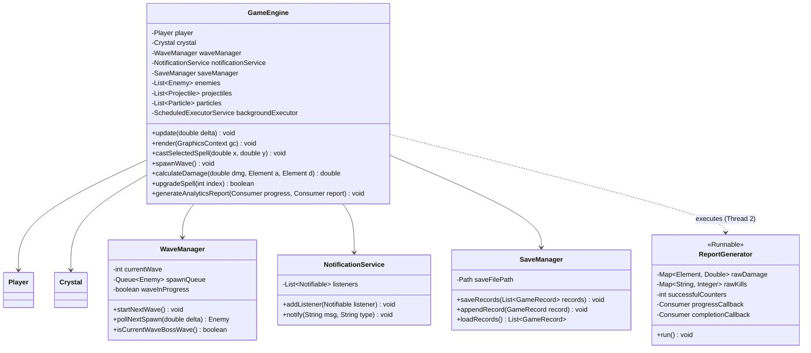

# Elemental Rift - UML Class Diagrams & Architecture

This document provides complete UML Class Diagrams using **Mermaid** notation, detailing inheritance hierarchies, interface realizations, associations, and multithreading communication pathways.

---

## 1. Complete Class Diagram (Entities, Spells & Interfaces)

```mermaid
classDiagram
    %% Interfaces
    class Drawable {
        <<interface>>
        +draw(GraphicsContext gc)* void
    }

    class Castable {
        <<interface>>
        +cast(Player player, double targetX, double targetY, List~Projectile~ projectiles)* void
        +getManaCost()* double
        +isReady()* boolean
    }

    class Upgradable {
        <<interface>>
        +upgrade()* void
        +getUpgradeCost()* int
        +getLevel()* int
        +getUpgradeDescription()* String
    }

    class Notifiable {
        <<interface>>
        +onNotification(String message, String type)* void
    }

    %% Entity Hierarchy
    class Entity {
        <<abstract>>
        -double x
        -double y
        -double width
        -double height
        -double health
        -double maxHealth
        -double speed
        -Element element
        -boolean alive
        +update(double delta)* void
        +takeDamage(double damage) double
        +heal(double amount) void
        +isAlive() boolean
        +distanceTo(Entity other) double
    }

    class Player {
        -double mana
        -double maxMana
        -double manaRegenRate
        -int gold
        -int score
        -int selectedSpellIndex
        -List~Spell~ spells
        -int enemiesDefeated
        -double aimAngle
        +spendMana(double amount) void
        +restoreMana(double amount) void
        +spendGold(int amount) boolean
        +addScore(int points) void
        +selectSpell(int index) void
        +getSelectedSpell() Spell
        +draw(GraphicsContext gc) void
    }

    class Enemy {
        <<abstract>>
        -double attackPower
        -double attackRange
        -double attackCooldown
        -double attackTimer
        -int goldReward
        -int scoreReward
        +updateEnemy(double delta, Crystal crystal) void
        +move(double delta, Crystal target)* void
        +attack(Crystal crystal)* void
        +takeElementalDamage(double dmg, Element el) double
        +drawHealthBar(GraphicsContext gc) void
    }

    class Goblin {
        -double bobbingTimer
        +move(double delta, Crystal target) void
        +attack(Crystal crystal) void
        +draw(GraphicsContext gc) void
    }

    class Golem {
        -double stompTimer
        +move(double delta, Crystal target) void
        +attack(Crystal crystal) void
        +draw(GraphicsContext gc) void
    }

    class Wraith {
        -double swayPhase
        +move(double delta, Crystal target) void
        +attack(Crystal crystal) void
        +draw(GraphicsContext gc) void
    }

    class Boss {
        -String bossTitle
        -boolean enraged
        +move(double delta, Crystal target) void
        +attack(Crystal crystal) void
        +draw(GraphicsContext gc) void
    }

    class Crystal {
        -double x
        -double y
        -double radius
        -double health
        -double maxHealth
        -boolean destroyed
        +takeDamage(double damage) boolean
        +heal(double amount) void
        +getCrackLevel() int
        +draw(GraphicsContext gc) void
    }

    %% Spell Hierarchy
    class Spell {
        <<abstract>>
        -String name
        -Element element
        -double baseDamage
        -double manaCost
        -double cooldown
        -double cooldownTimer
        -int level
        +updateCooldown(double delta) void
        +triggerCooldown() void
        +preCastCheck(Player player) void
        +getEffectDescription()* String
        +upgrade() void
    }

    class FireSpell {
        +cast(Player player, double tx, double ty, List~Projectile~ projs) void
        +getEffectDescription() String
    }

    class WaterSpell {
        +cast(Player player, double tx, double ty, List~Projectile~ projs) void
        +getEffectDescription() String
    }

    class AirSpell {
        +cast(Player player, double tx, double ty, List~Projectile~ projs) void
        +getEffectDescription() String
    }

    class EarthSpell {
        +cast(Player player, double tx, double ty, List~Projectile~ projs) void
        +getEffectDescription() String
    }

    %% Other Models
    class Projectile {
        -double x
        -double y
        -double vx
        -double vy
        -double damage
        -Element element
        -int pierceRemaining
        +update(double delta) void
        +registerHit() boolean
        +collidesWith(Entity entity) boolean
        +draw(GraphicsContext gc) void
    }

    class Particle {
        -double x
        -double y
        -double life
        -Color color
        +update(double delta) void
        +isDead() boolean
        +draw(GraphicsContext gc) void
    }

    %% Realizations
    Drawable <|.. Entity
    Drawable <|.. Crystal
    Drawable <|.. Projectile
    Drawable <|.. Particle
    Castable <|.. Spell
    Upgradable <|.. Spell

    %% Inheritance
    Entity <|-- Player
    Entity <|-- Enemy
    Enemy <|-- Goblin
    Enemy <|-- Golem
    Enemy <|-- Wraith
    Enemy <|-- Boss
    Spell <|-- FireSpell
    Spell <|-- WaterSpell
    Spell <|-- AirSpell
    Spell <|-- EarthSpell
```



---

## 2. Service & Engine Architecture Diagram



---

## 3. Multithreading & Event Concurrency Flow

```mermaid
sequenceDiagram
    autonumber
    actor User as Player / Input
    participant UI as GameScreen / UI Thread
    participant Loop as AnimationTimer (60 FPS)
    participant Engine as GameEngine
    participant Worker1 as ScheduledExecutor (Thread 1)
    participant Worker2 as ReportGenerator (Thread 2)

    User->>UI: Left-Click Canvas / Press '1'-'4'
    UI->>Engine: castSelectedSpell(x, y)
    Engine-->>UI: Notifies via NotificationService (Platform.runLater)

    Worker1->>Engine: Passive Mana Regeneration (every 500ms)
    Worker1->>Engine: Wave Spawn Cadence Check (every 200ms)
    Engine-->>UI: Platform.runLater(Wave cleared alert)

    Loop->>Engine: update(delta)
    Engine->>Engine: Collision detection & Elemental counters
    Loop->>Engine: render(gc)
    Engine->>UI: Draw Canvas Frame

    User->>UI: Click "Generate Deep Analytics"
    UI->>Engine: generateAnalyticsReport()
    Engine->>Worker2: backgroundExecutor.execute(ReportGenerator)
    Worker2-->>UI: Platform.runLater(progress 20% -> 50% -> 80% -> 100%)
    Worker2-->>UI: Platform.runLater(display AnalyticsReport)
```
